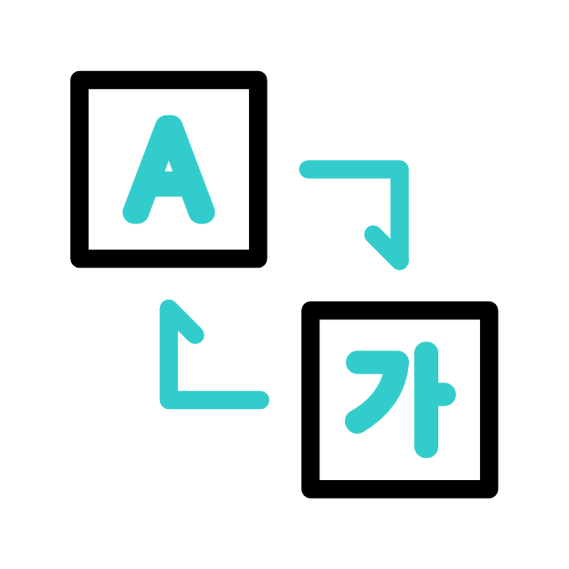

## About time!

After more than two years, I am returning to this project, which I had left neglected, in the hope that I will not do that again (though I am not making any promises). So what has changed to make me decide to update this website? Basically, something I had tried back then, but which was not yet implemented, now seems to work: setting up a multilingual system.

At one point I thought, “*Hey, my website is looking pretty abandoned and out-of-date*,” and when I started looking into the progress Quarto had made over the past few years, I was blown away. This update started as a facelift and ended up becoming a fairly comprehensive overhaul: a clearer presentation, updated content, and, above all, a bilingual structure in Spanish and English.

The underlying technology remains the same: Quarto and R. The main addition is [`babelquarto`](https://docs.ropensci.org/babelquarto/), the package that has allowed me to organize both versions without maintaining two separate sites.

## A website in Spanish and English

{fig-align="center"}

When I developed the first version of this website, I had already tried to make it bilingual. After plenty of attempts and experiments, I realized that, even if it was possible, doing so would be a huge headache. At the time, I settled for a clunky but practical solution: linking to the Spanish content from the English content, and vice versa.

But of course, the original idea was for the entire website to be readable independently in either language. The navigation, footers, project pages, and the rest of the content needed to remain consistent across languages. To achieve this, as I mentioned earlier, I used `babelquarto`, an R package that organizes the rendering of multilingual Quarto projects and links their language versions.

### What `babelquarto` does (and does not do)

I am still in love with Quarto. Since discovering it, I have moved entirely to this format, and I use it for all the documents in my day-to-day work. Quarto therefore remains the engine that transforms source documents into the website's pages. `babelquarto` adds the coordination needed to generate the different versions, organizing the rendering of each language and linking the corresponding pages. It does not translate content automatically: the Spanish and English texts are maintained in separate source files.

This distinction matters. Automating a website's build process does not remove the need to review its translations, links, and references.

### File organization

Spanish is the main language. Its pages retain the usual Quarto filenames, while the English translations add the `.en` suffix:

```text
index.qmd
index.en.qmd

about/
├── index.qmd
├── index.en.qmd
├── resume.qmd
├── resume.en.qmd
├── outreach.qmd
└── outreach.en.qmd
```

The same structure is used for blog posts and project pages.

This convention keeps the two versions of a page together and gives `babelquarto` the pattern it needs to identify translations of documents in the main language. It also makes it easier to translate all the content while preserving the same format.

### Language configuration

In `_quarto.yml`, Spanish is defined as the main language and English as an additional language:

```yaml
lang: es

babelquarto:
  mainlanguage: es
  languages: [en]
  languagelinks: navbar
  languagecodes:
    - name: es
      text: "ES"
    - name:babelquarto::render_website(project_path = ".", site_url = "", preview = TRUE)
 en
      text: "EN"
```

`mainlanguage` identifies the main language; `languages` contains the additional languages, and `languagecodes` defines the labels visitors will see as they browse the website.

In the output, the Spanish version is placed at the site's root and the English version under `/en/`. Equivalent pages therefore retain a recognizable structure:

```text
/about/resume.html
/en/about/resume.html
```

### Shared configuration and language-specific profiles

I have also separated the shared configuration from the settings specific to each version:

```text
_quarto.yml
_quarto-es.yml
_quarto-en.yml
```

The main file contains the theme, resources, and general options. The language profiles define elements such as menu and footer text, while the `_quarto-es.yml` and `_quarto-en.yml` profiles allow those settings to be applied when rendering each language.

This avoids duplicating the entire configuration and makes it possible to change a visual feature just once for both versions.

## A language switcher that fits the design

Bilingual navigation also needed to fit the website's appearance. To achieve this, I adapted the switcher generated by `babelquarto` to display a compact ES/EN button in the top navigation bar. The button uses the link to the translation of the current page, rather than always sending visitors to the other language's homepage. This customization is not necessary: the package already provides a language dropdown by default, but I preferred the more compact design.

## A single entry point: render.R

To ensure that both versions are generated correctly in HTML, render certain elements during the website build, and check everything's integrity throughout the process, we have a small `render.R` script.

The bilingual build is performed with a call like this, where `site_url` contains the website's public address:

```r
babelquarto::render_website(
  project_path = ".",
  site_url = site_url,
  preview = FALSE
)
```

This makes it possible to preview the website locally with the language switcher (which is very handy when testing, as I can confirm).
