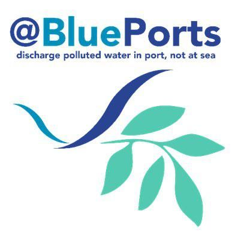

### Project Participation

January 2017 - July 2019

# About the Project:

{fig-align="center"}

[@BLUEPORTS](https://maritime-spatial-planning.ec.europa.eu/projects/atlantic-blue-port-services-discharge-polluted-water-port-not-sea) aims to provide a practical support to the European Sustainable Shipping Forum/European Maritime Safety Agency, using the Atlantic Area as a physical platform and its maritime community as a resource to design, prototype, test and demonstrate the “ideal” Port Reception Facility and services for oiled and ballast water (as first concern). The overall goal is to raise awareness and motivation within the maritime community to stop discharge at sea by designing in consensus the "Blue Port Services" for 2020 and beyond.

{fig-align="center"}

# My Role in the Project
I participated in the BluePorts project as part of my doctoral dissertation in the Department of Functional Biology at the University of Oviedo, within the [ARENA group](https://arena.grupos.uniovi.es/). My research focused on marine debris and its biological risks, with special attention to its role as a substrate and potential vector for the dispersal of non-native species.

In this context, we conducted a genetic study of the coastal flora and fauna of the Port of Gijón and its surrounding areas to characterize the composition of these ecosystems and identify the presence of invasive alien species (IAS).

My contribution combined direct observation and genetic tools to identify organisms associated with marine debris and to study the links between the port and nearby coastal ecosystems.

## Related Publications
The following articles present results related to this line of research. Their inclusion here does not imply that all were funded exclusively by the BluePorts project.

- [Alert calling in port areas: Marine litter as possible secondary dispersal vector for hitchhiking invasive species](https://doi.org/10.1016/j.jnc.2018.01.005)
- [Environmental DNA from plastic and textile marine litter detects exotic and nuisance species nearby ports](https://doi.org/10.1371/journal.pone.0228811)
- [Public awareness of beach litter and alien invasions: Implications for early detection and management](https://doi.org/10.1016/j.ocecoaman.2022.106040)
- [Flotsam, an overlooked vector of alien dispersal from ports](https://doi.org/10.1016/j.ecss.2022.107879)