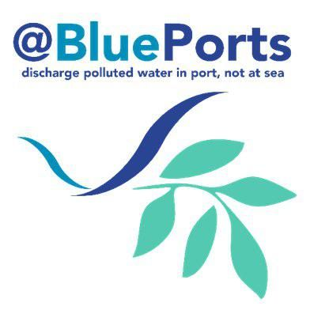

### Participación en el proyecto

Enero de 2017 - julio de 2019

# Sobre el proyecto:

{fig-align="center"}

[@BLUEPORTS](https://maritime-spatial-planning.ec.europa.eu/projects/atlantic-blue-port-services-discharge-polluted-water-port-not-sea) tiene como objetivo prestar un apoyo práctico al Foro Europeo de Transporte Marítimo Sostenible y a la Agencia Europea de Seguridad Marítima, utilizando el Espacio Atlántico como plataforma física y a su comunidad marítima como recurso para diseñar, prototipar, probar y demostrar la instalación portuaria de recepción y los servicios «ideales» para las aguas oleosas y de lastre (como prioridad). El objetivo general es aumentar la concienciación y la motivación de la comunidad marítima para acabar con los vertidos en el mar, diseñando de forma consensuada los «Blue Port Services» para 2020 y en adelante.

{fig-align="center"}

# Mi papel en el proyecto
Participé en el proyecto BluePorts como parte de mi tesis doctoral en el Departamento de Biología Funcional de la Universidad de Oviedo, dentro del [grupo ARENA](https://arena.grupos.uniovi.es/). Mi investigación se centró en la basura marina y sus riesgos biológicos, con especial atención a su papel como sustrato y posible vector de dispersión de especies no autóctonas.

En este contexto, realizamos un estudio genético de la flora y la fauna costeras del puerto de Gijón y de las zonas de su entorno para caracterizar la composición de estos ecosistemas e identificar la presencia de especies exóticas invasoras (EEI).

Mi contribución combinó la observación directa y las herramientas genéticas para identificar organismos asociados a residuos marinos y estudiar los vínculos entre el puerto y los ecosistemas costeros cercanos.

## Publicaciones relacionadas
Los siguientes artículos recogen resultados relacionados con esta línea de investigación. Su inclusión aquí no implica que todos se financiaran exclusivamente con el proyecto BluePorts.

- [Alert calling in port areas: Marine litter as possible secondary dispersal vector for hitchhiking invasive species](https://doi.org/10.1016/j.jnc.2018.01.005)
- [Environmental DNA from plastic and textile marine litter detects exotic and nuisance species nearby ports](https://doi.org/10.1371/journal.pone.0228811)
- [Public awareness of beach litter and alien invasions: Implications for early detection and management](https://doi.org/10.1016/j.ocecoaman.2022.106040)
- [Flotsam, an overlooked vector of alien dispersal from ports](https://doi.org/10.1016/j.ecss.2022.107879)