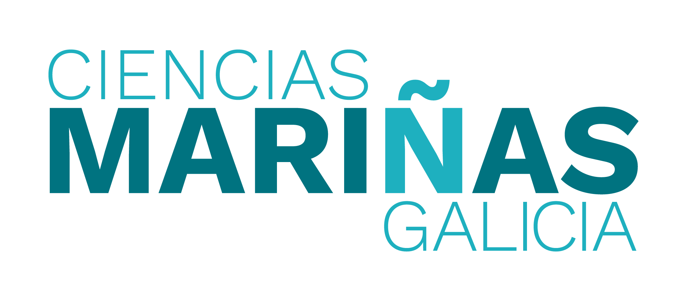
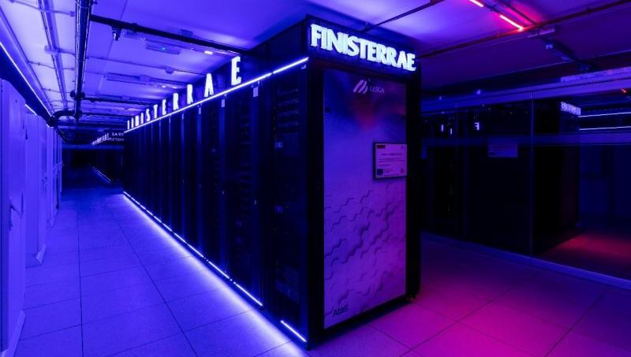

### Duración del proyecto

Abril de 2023 - abril de 2025

# Sobre el proyecto:

{fig-align="center"} El *Programa de Ciencias Mariñas de Galicia*, proyecto de investigación español financiado con [fondos europeos NextGenerationEU](https://next-generation-eu.europa.eu/index_es), forma parte del [proyecto ThinkInAzul](https://thinkinazul.es/). 

[{fig-alt="Logotipo de ThinkInAzul"} Logotipo de ThinkInAzul]{.aside}

Reconocida por su complejidad, la ciencia de la sostenibilidad requiere enfoques de investigación interdisciplinares y ambiciosos. Esta complejidad pone de relieve la necesidad de una investigación que equilibre la amplitud con la búsqueda de impactos concretos y demostrables, más allá de la generación de nuevo conocimiento científico. Galicia, con sus 1.400 km de costa, sus singulares rías y sus diversos ecosistemas, junto con una elevada densidad de población y una estructura económica y social dependiente del mar, ofrece un contexto ideal para este tipo de iniciativas de investigación marina.

Ante el cambio global, es fundamental que la comunidad científica intensifique sus esfuerzos para comprender el estado del medio y de los recursos marinos, identificar las zonas vulnerables, predecir escenarios futuros —especialmente los relacionados con el cambio global— y desarrollar medidas que garanticen la explotación sostenible de las especies de interés comercial y de los ecosistemas marinos, la conservación de la biodiversidad, la protección de los ecosistemas vulnerables y la salud general del medio marino. La resiliencia del medio marino y de la sociedad, así como el bienestar y la salud de la población, dependen en gran medida de los avances en estos ámbitos. Este es el enfoque estratégico del Programa de Ciencias Mariñas de Galicia.

# Mi papel en el proyecto

El paquete de trabajo 3 del programa de ciencias marinas tiene como objetivo adaptar nuevas tecnologías analíticas y ópticas (entre otras) al estudio de las comunidades planctónicas, con el fin de analizar su estado como medida de la calidad ambiental. Para ello, nuestro grupo de trabajo realiza muestreos de plancton junto con otras variables oceánicas esenciales (EOV). También hemos incorporado nuevas tecnologías para la caracterización del plancton mediante análisis de imagen ([Cytosense](https://www.cytobuoy.com/products/cytosense-c/) y [Planktoscope](https://www.planktoscope.org/)). Mis tareas en este proyecto consisten en adaptar y actualizar la base de datos para albergar todos estos nuevos datos, junto con otros generados en el marco del *Programa de Ciencias Mariñas*, así como en analizarlos para informes técnicos y artículos científicos.

[{fig-alt="Supercomputador Finisterrae"} El supercomputador Finisterrae, donde se aloja la base de datos]{.aside}
Con este fin, estamos ampliando, remodelando y migrando la base de datos a los servidores del [Centro de Supercomputación de Galicia](https://www.cesga.es/), lo que mejora su acceso y escalabilidad, así como su capacidad de interacción con otras bases de datos del proyecto y externas.
