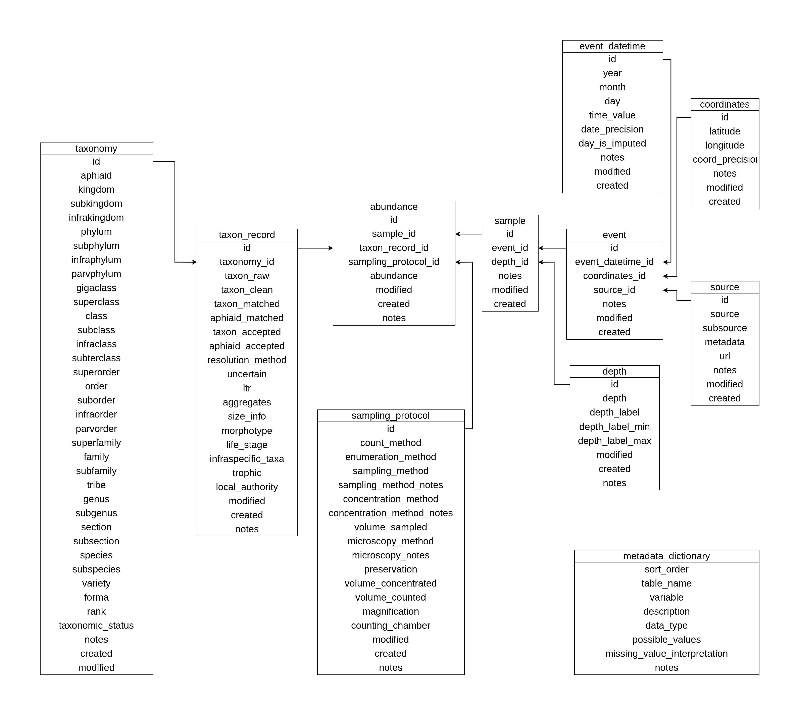

### Involvement in the project

June 2025 – present

# About the project
The Marine Phytoplankton Atlas (Phyto-MAP) project brings together observations of the presence/absence and abundance of marine phytoplankton, with a particular focus on records obtained through microscopy and identified to species or genus level.

Its objectives are:

- To facilitate the analysis of observations on an oceanic scale by integrating numerous sources into a common format
- To support the development and validation of species distribution models
- To improve our understanding of the niches of different phytoplankton groups and species
- To produce a global map of marine phytoplankton

## My contribution
My work focuses on integrating and harmonising observations from different sources to produce a coherent dataset suitable for research. To this end, I develop tools in R and work with relational databases that link records to their sampling, location, depth and taxonomic information.

This process involves reviewing the data structure, standardising variables and units, refining taxonomic names and documenting the decisions made. Validation checks enable us to assess the consistency of the output and identify its limitations before using it in ecological analyses.

## Products and resources
### Phyto-MAP database

{fig-align="center"}

A relational database of marine phytoplankton abundance, available in SQLite and CSV formats. It includes harmonised observations and their metadata, a bibliography of sources, a variable dictionary and technical validation documentation.

[ Data and documentation](https://doi.org/10.5281/zenodo.23424052)

### Processing scripts
A collection of scripts for source processing, taxonomic curation and the construction of the relational database, accompanied by workflow documentation.

[ Code](https://github.com/RayonVina/phytomap-scripts) ·
[ Archive on Zenodo](https://doi.org/10.5281/zenodo.23351062)

### PhyTaxR
An R package for cleaning, standardising and resolving taxonomic names of phytoplankton. It combines automatic resolution with interactive review of close matches.

[ Code](https://github.com/RayonVina/phytaxr) ·
[ Software on Zenodo](https://doi.org/10.5281/zenodo.21905974) ·
[ PhyTaxR preprint](https://doi.org/10.64898/2026.10.23.761320)

## Usage considerations
Harmonisation does not eliminate differences between sources in terms of methods, sampling effort or taxonomic resolution. These differences must be taken into account when comparing records and interpreting results.

The published scripts document the preserved programmatic components of the processing, but do not constitute a standalone pipeline for fully regenerating the database.