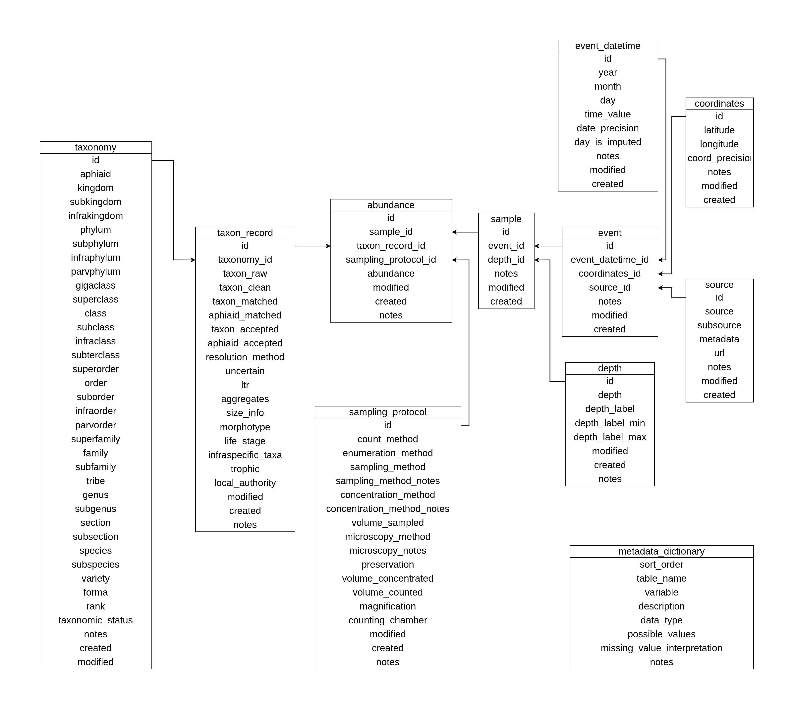

### Participación en el proyecto

Junio de 2025 - actualidad

# Sobre el proyecto
El proyecto Atlas Marino del Fitoplancton (Phyto-MAP) reúne observaciones de presencia/ausencia y abundancia de fitoplancton marino, con especial atención a los registros obtenidos mediante microscopía e identificados a nivel de especie o género.

Sus objetivos son:

- Facilitar el análisis de las observaciones a escala oceánica mediante la integración de numerosas fuentes en un formato común
- Apoyar el desarrollo y la validación de modelos de distribución de especies
- Mejorar el conocimiento de los nichos de los distintos grupos y especies de fitoplancton
- Elaborar un mapa global del fitoplancton marino

## Mi contribución
Mi trabajo se centra en integrar y armonizar observaciones de distintas fuentes para obtener un conjunto de datos coherente y utilizable en investigación. Para ello, desarrollo herramientas en R y trabajo con bases de datos relacionales que vinculan los registros con su información de muestreo, localización, profundidad y taxonomía.

Este proceso incluye revisar la estructura de los datos, estandarizar variables y unidades, depurar nombres taxonómicos y documentar las decisiones adoptadas. Las comprobaciones de validación permiten evaluar la coherencia del producto y reconocer sus limitaciones antes de utilizarlo en análisis ecológicos.

## Productos y recursos
### Base de datos Phyto-MAP

{fig-align="center"}

Base de datos relacional de abundancia de fitoplancton marino, disponible en SQLite y CSV. Incluye observaciones armonizadas y sus metadatos, bibliografía de las fuentes, un diccionario de variables y documentación de validación técnica.

[ Datos y documentación](https://doi.org/10.5281/zenodo.23424052)

### Scripts de procesamiento
Colección de scripts para el tratamiento de las fuentes, la curación taxonómica y la construcción de la base de datos relacional, acompañados de documentación del flujo de trabajo.

[ Código](https://github.com/RayonVina/phytomap-scripts) ·
[ Archivo en Zenodo](https://doi.org/10.5281/zenodo.23351062)

### PhyTaxR
Paquete de R para limpiar, estandarizar y resolver nombres taxonómicos de fitoplancton. Combina la resolución automática con la revisión interactiva de coincidencias aproximadas.

[ Código](https://github.com/RayonVina/phytaxr) ·
[ Software en Zenodo](https://doi.org/10.5281/zenodo.21905974) ·
[ Preprint de PhyTaxR](https://doi.org/10.64898/2026.10.23.761320)

## Consideraciones de uso
La armonización no elimina las diferencias entre fuentes en métodos, esfuerzo de muestreo o resolución taxonómica. Estas diferencias deben tenerse en cuenta al comparar registros e interpretar los resultados.

Los scripts publicados documentan los componentes programáticos conservados del procesamiento, pero no constituyen una cadena autónoma para regenerar íntegramente la base de datos.