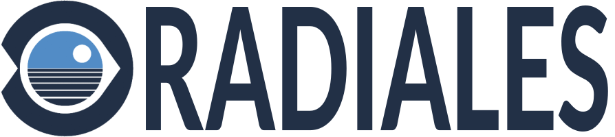
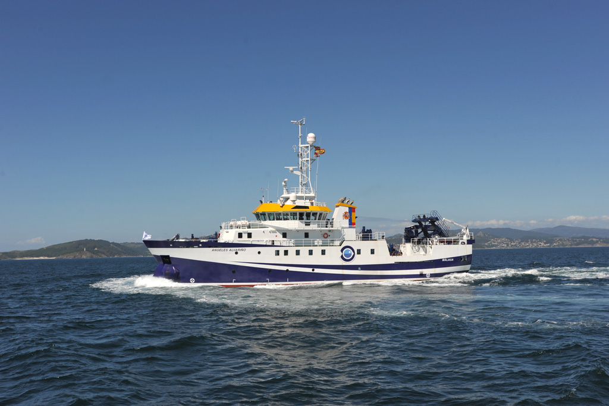
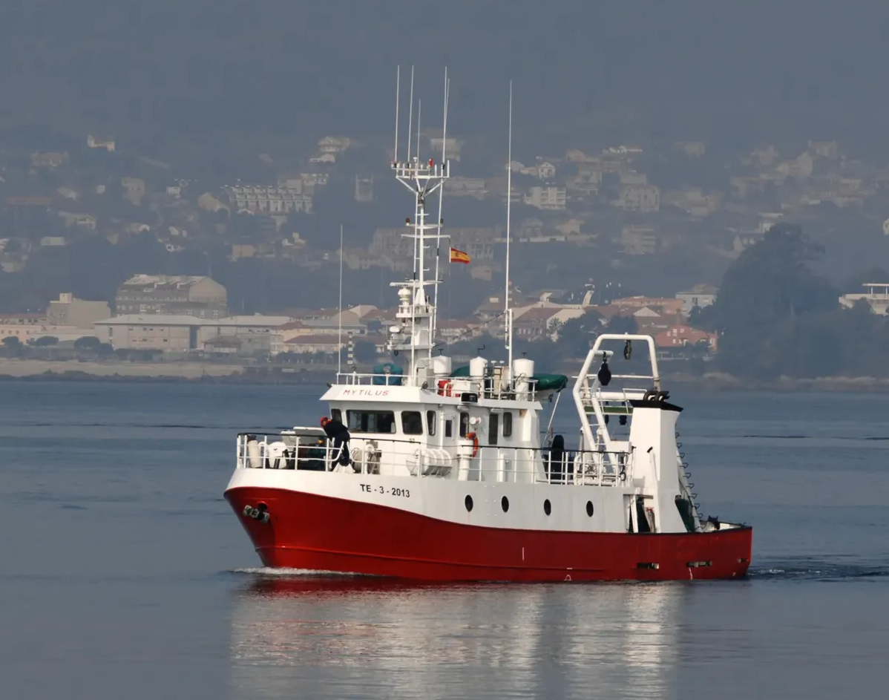
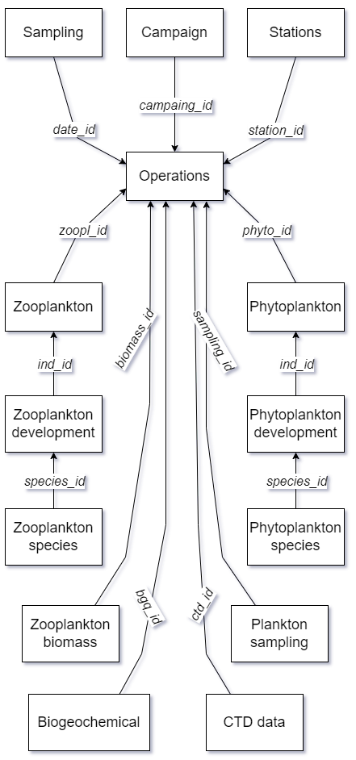

### Duración del proyecto

Abril de 2020 - abril de 2025

# Sobre el proyecto:

{fig-align="center"}

El [Instituto Español de Oceanografía (IEO)](https://www.ieo.es/es_ES/web/ieo) lleva a cabo programas sistemáticos de observación del océano para interpretar los cambios en los ecosistemas marinos. Estos ecosistemas están influidos por la variabilidad natural, temporal y espacial, así como por actividades humanas como la pesca, la contaminación y el calentamiento global. En el marco de [{fig-alt="B/O Ángeles Alvariño, uno de los buques oceanográficos que realizan las campañas RADIALES."} B/O Ángeles Alvariño, uno de los buques oceanográficos que realizan las campañas RADIALES.]{.aside} iniciativas científicas internacionales, el IEO ha recogido y analizado series temporales de datos oceanográficos desde los años ochenta. Las observaciones comenzaron en la costa de Galicia y posteriormente se extendieron a las costas cantábrica y mediterránea. En 2007, el programa de observación se dividió en dos proyectos:[{fig-alt="B/O Mytilus, el buque más utilizado en la RADIAL de Vigo."} B/O Mytilus, el buque más utilizado en la RADIAL de Vigo.]{.aside} [RADIALES](https://www.seriestemporales-ieo.net/), que mantiene observaciones mensuales en la costa norte de España, y RADMED, centrado en las costas mediterráneas con una frecuencia estacional. Las observaciones de aguas profundas comenzaron también en 2004 en Galicia y el Cantábrico (RADPROF) y en 2006 en Canarias (RAPROCAN). Estos proyectos, junto con las redes de mareógrafos y las estaciones de recepción de datos de satélite, constituyen la base del programa de observación oceánica permanente del IEO.

# Mi papel en el proyecto

Por la naturaleza del proyecto, cada centro oceanográfico genera cada año una enorme cantidad de datos para múltiples variables oceánicas esenciales (EOV). Dentro del plan para mejorar la información recogida en el proyecto, mi principal función es diseñar y poner en marcha la base de datos VGOHAdB, que almacena todos los datos producidos por nuestro grupo de investigación.

{fig-align="center" width="400"}

Mis principales responsabilidades en este proyecto son diseñar, crear y mantener la base de datos, integrando principalmente los datos del programa RADIALES Vigo. Para ello se ha desarrollado un flujo de trabajo que facilita una recogida óptima de los datos para su posterior análisis, homogeneización y carga en la base de datos. Se trata de una base de datos relacional en PostgreSQL, con una estructura de datos separada por orígenes y tipos de datos, relacionados mediante identificadores únicos de las operaciones realizadas.
